<p align="center">
  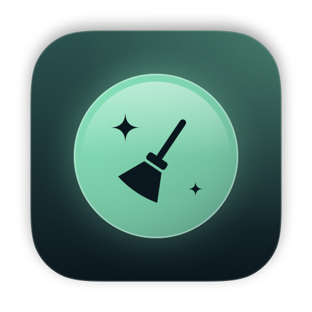
</p>

<h1 align="center">TidyMyMac</h1>

<p align="center">
  <strong>The free and open-source alternative to CleanMyMac.</strong><br>
  Clean up, speed up and search your Mac — everything runs locally, nothing is sent anywhere.
</p>

<p align="center">
  <a href="LICENSE"></a>
  
  
  
</p>

<p align="center">
  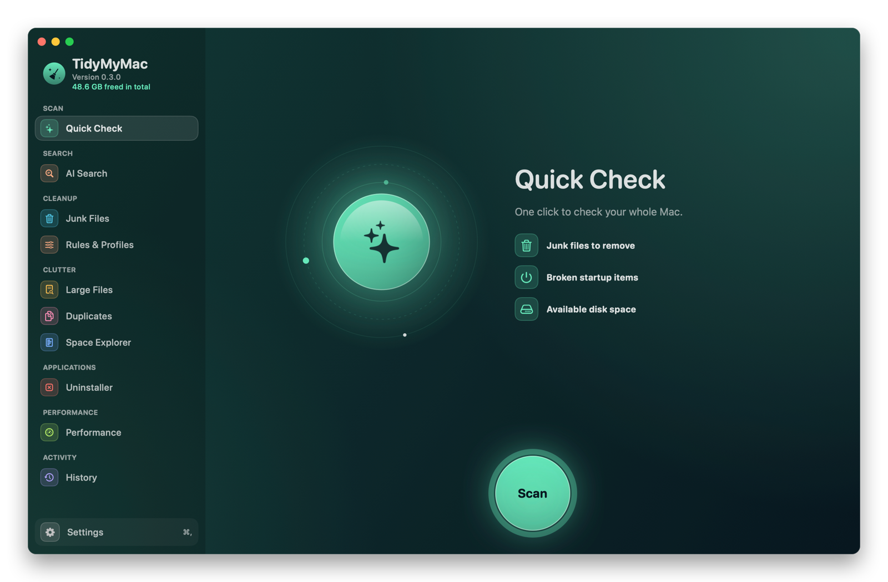
</p>

> 🇫🇷 **L'alternative gratuite et open source à CleanMyMac.** L'app est disponible en français, anglais, espagnol et allemand.

## Why TidyMyMac

- **Free and open source**: MIT license, no subscription, no account, no upsell.
- **Transparent**: you see every file before it goes, and personal files always go to the Trash first.
- **Private**: no telemetry. AI Search runs on your Mac with an open-source model; your files never leave it.
- **Native**: a Swift and SwiftUI app with no third-party dependencies.

## Features

| | |
| --- | --- |
| **Quick Check** | One click to find junk files, broken startup items and how much disk space is left, then clean up in place. |
| **Junk Files** | App caches, logs, Xcode DerivedData, device support files and archives, simulator caches, npm / Gradle / Cargo caches, Mail attachments, downloaded installers, iOS backups and the Trash. Each category shows its risk level and what happens once it’s removed. |
| **Rules & Profiles** | Turn on ready-made profiles (developer, photographer, video editor), switch any rule off, or create your own rules with a simple form and test them before use. |
| **AI Search** | Find a document by describing it — *“my liability insurance certificate”* — even if its file name says nothing. Reads PDFs, Word files and scans (OCR). |
| **Large Files** | Files and packages above a size threshold, with their last-opened date. |
| **Duplicates** | Identical files grouped by content (SHA-256), always keeping one copy. |
| **Space Explorer** | See what fills your disk as bubbles or as a list, then select several items to reveal or remove. |
| **Uninstaller** | Remove an app with its leftovers in `~/Library`, or reset an app by deleting only its data. |
| **Performance** | Recommendations first, then detailed managers: maintenance tasks (RAM, DNS, Time Machine snapshots, Spotlight, Mail, Launch Services) with measured gains, login apps and background items. |
| **History** | Every cleanup, uninstall and maintenance run, item by item: where each file went (Trash or deleted), what was freed over time, with CSV and JSON export. |
| **Menu bar** | Live Mac health — disk, memory, CPU, battery, network with speed test, connected volumes — plus a search bar for AI Search. |

After every action, TidyMyMac shows what was actually freed, along with a running total.

### AI Search

<p align="center">
  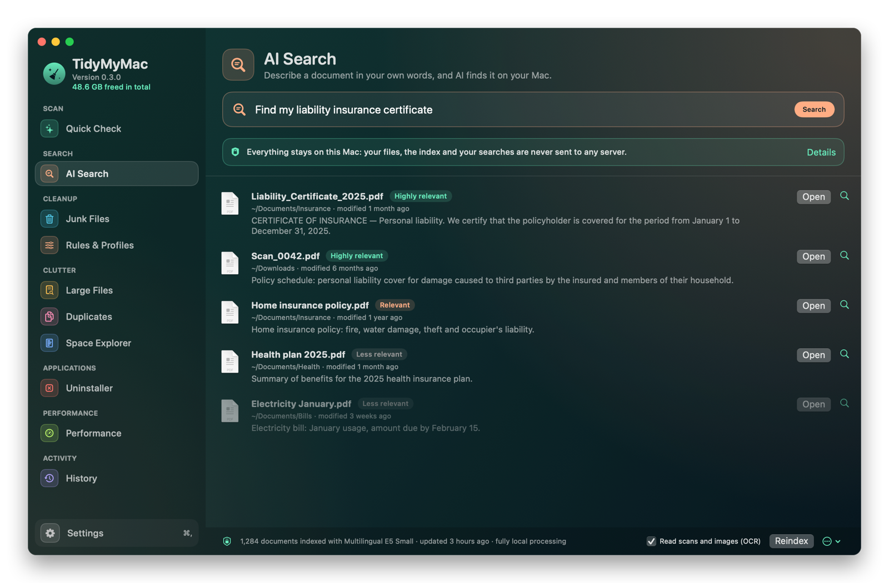
</p>

Describe the file in your own words and TidyMyMac ranks your documents by meaning, not just by name. It indexes
Documents, Downloads and Desktop, reads text inside PDFs and Word files, and recognises text in scans and photos.

### Junk Files

<p align="center">
  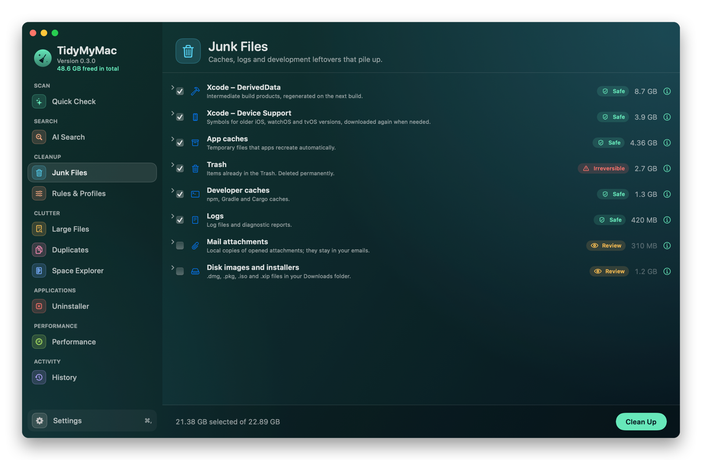
</p>

Every category carries a risk level — **Safe** (recreated automatically), **Review** (may hold something worth keeping,
unchecked by default) or **Irreversible** (deleted for good) — and the ⓘ button explains what the rule removes, what
happens afterwards and where it looks.

<p align="center">
  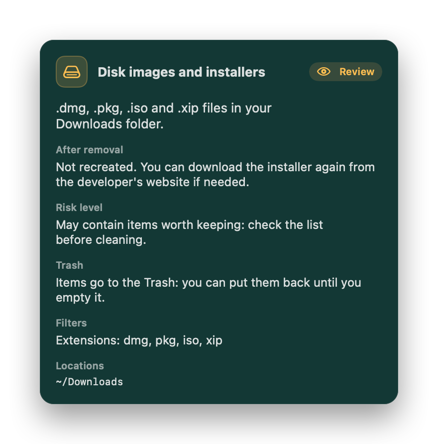
</p>

### Rules & Profiles

<p align="center">
  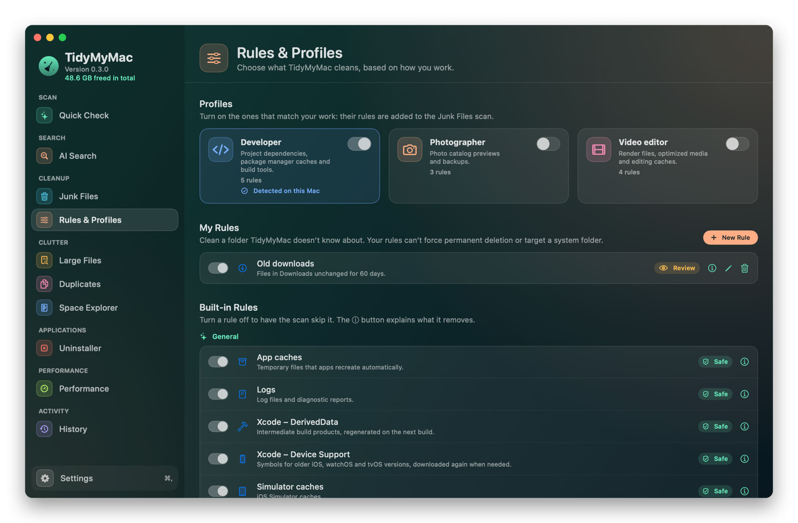
</p>

Turn on the profiles that match your work to add rules for their tools: `node_modules` folders and package caches
for developers, Lightroom previews for photographers, render files and media caches for video editors. Create your
own rules with a form — folders, filters, risk level — and test them before they run. See
[docs/RULES.md](docs/RULES.md) for the details and the safety limits that apply to every rule.

### Space Explorer

<p align="center">
  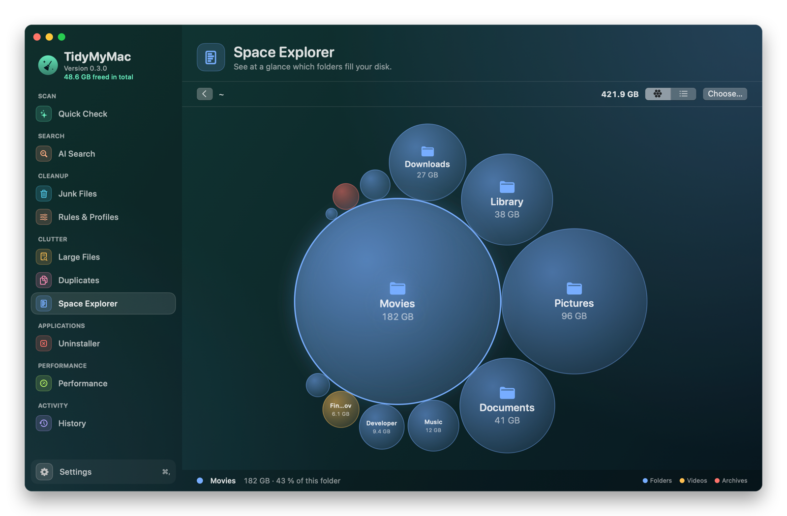
</p>

Each bubble's area matches the item's size and its colour shows the file type. Double-click a folder to dive in,
click to select, and move several items to the Trash at once.

### History

<p align="center">
  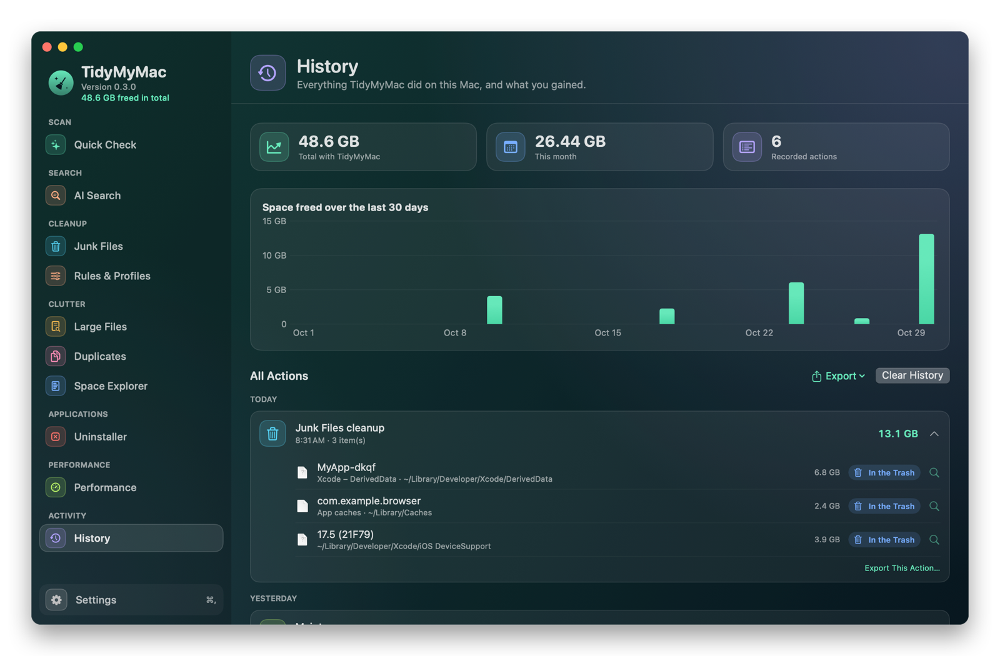
</p>

TidyMyMac keeps a local journal of everything it does: each removed item with its original path, its size and
whether it went to the Trash or was deleted for good, plus maintenance tasks and their measured gains. Export it to
CSV or JSON at any time.

### Performance

<p align="center">
  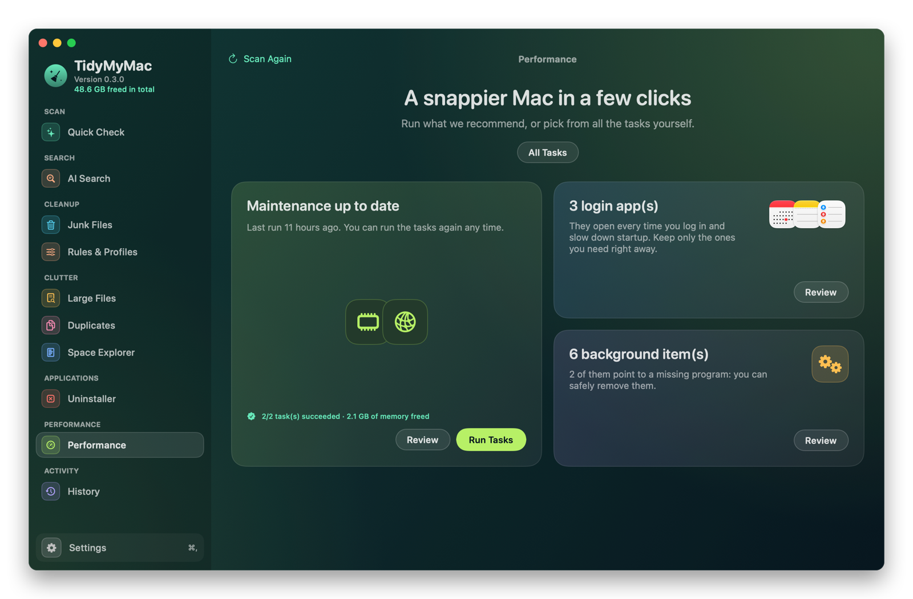
</p>

### Menu bar and settings

<p align="center">
  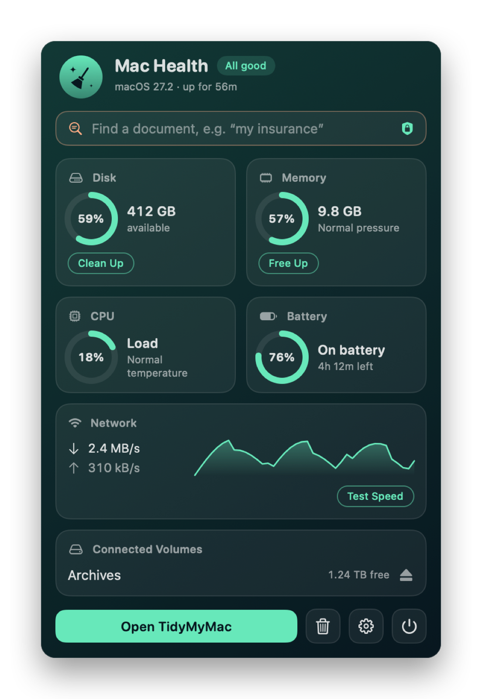
  &nbsp;&nbsp;
  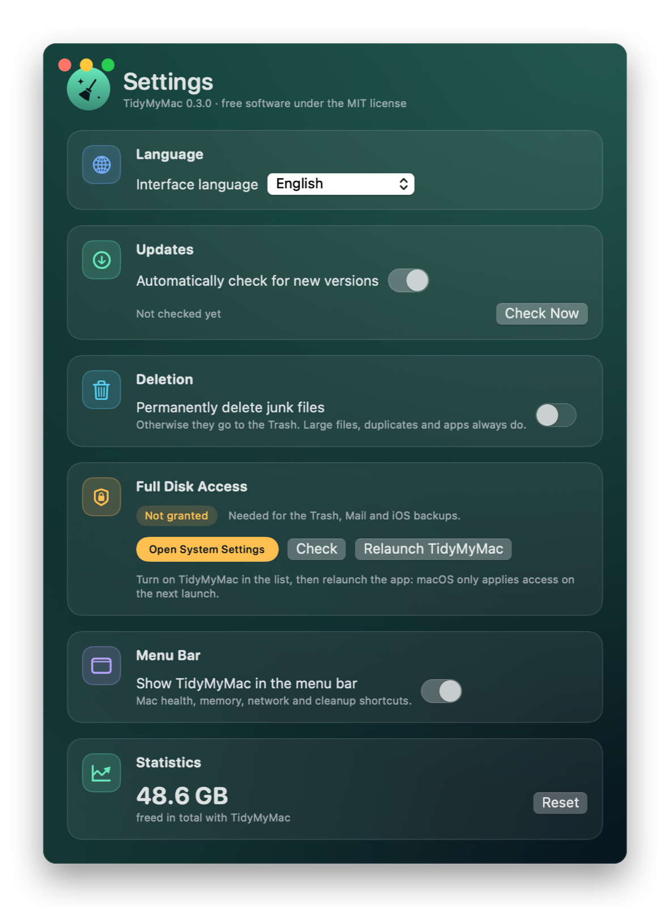
</p>

## Privacy

AI Search indexes and searches **entirely on your Mac**:

- document text is read and analysed locally, including text recognition in scans (Apple Vision, on-device);
- the AI model runs on your Mac's processor, without calling any online service;
- the index stays in `~/Library/Application Support/TidyMyMac/Search` and can be deleted from the app at any time;
- searches are neither sent nor stored.

The action history is stored the same way, in `~/Library/Application Support/TidyMyMac/Journal`, and can be cleared
from the app.

The only network access of AI Search is the one-time model download from Hugging Face (pinned revision, SHA-256
checked). It sends none of your data. The only other network call in the app is the optional update check against
GitHub Releases.

## Installation

### Download

1. Download `TidyMyMac-x.y.z.zip` from the [Releases](../../releases) page.
2. Unzip it and move **TidyMyMac.app** to your **Applications** folder.
3. The app is not notarized by Apple yet, so macOS blocks the first launch. Open **System Settings › Privacy &
   Security**, scroll down and click **Open Anyway**. Alternatively, run:

   ```sh
   xattr -dr com.apple.quarantine /Applications/TidyMyMac.app
   ```

### Build from source

You need macOS 13 or later and the Command Line Tools (`xcode-select --install`). Xcode itself is not required.

```sh
git clone https://github.com/Pareilart/TidyMyMac.git
cd TidyMyMac
./scripts/setup-signing.sh   # optional, see below
./build.sh
open build/TidyMyMac.app
```

`build.sh` produces `build/TidyMyMac.app` and a zip archive ready to publish.

An ad-hoc signed app gets a new identity on every build, so macOS forgets the permissions you granted.
`scripts/setup-signing.sh` creates a local signing identity once (it asks for your login password), and `build.sh`
then uses it so permissions survive rebuilds.

### Permissions

| Permission | Used for |
| --- | --- |
| **Full Disk Access** | The Trash, Mail and iOS backups. Grant it in System Settings › Privacy & Security, then relaunch the app. |
| **Documents, Downloads and Desktop** | Indexing for AI Search. |
| **Automation (System Events)** | Listing and removing login apps. |
| **Administrator password** | Only for system tasks (RAM, DNS, Spotlight, snapshots) and system-wide background items, asked once per run. |

## Safety

- Large files, duplicates and apps always go to the **Trash**. Junk files do too by default; a setting lets you delete
  them permanently.
- Duplicates always keep at least one copy.
- Nothing is removed without being listed first, with its size and location.
- Every junk category states its risk level and what happens after removal. No rule can remove a system folder or a
  personal folder such as Documents, or sweep your whole home or Library folder.
- System actions go through the standard macOS administrator prompt.

## AI Search models

Choose the model under **AI Search › Change Model…**. Every model keeps its own index.

| Model | License | Languages | Size |
| --- | --- | --- | --- |
| `intfloat/multilingual-e5-small` (recommended) | MIT | Multilingual | 488 MB |
| `ibm-granite/granite-embedding-107m-multilingual` | Apache 2.0 | Multilingual | 223 MB |
| `sentence-transformers/paraphrase-multilingual-MiniLM-L12-v2` | Apache 2.0 | Multilingual | 480 MB |
| `intfloat/multilingual-e5-base` | MIT | Multilingual | 1.1 GB |
| `sentence-transformers/all-MiniLM-L6-v2` | Apache 2.0 | English | 91 MB |

You can also add any compatible Hugging Face model by its `owner/model` id: BERT, RoBERTa, XLM-RoBERTa or CamemBERT
architecture, safetensors weights (F32, BF16 or F16), and a Unigram or WordPiece tokenizer. TidyMyMac checks
compatibility before downloading anything. The models run in pure Swift with Accelerate, with no Python or external
runtime.

## Languages

TidyMyMac is available in **English, French, Spanish and German**. It follows your macOS language by default, and
you can pick another one under **Settings › Language** — the interface switches instantly, without relaunching.

To add a language, copy `Resources/Localization/en.lproj` to a new folder (for example `it.lproj`), translate the
values, add the language code to `CFBundleLocalizations` in `Resources/Info.plist`, and run
`./scripts/check-translations.sh` to list anything left untranslated. Keys are the original French texts; `%@` stands
for a text and `%lld` for a number.

## Development

| Path | Contents |
| --- | --- |
| `Sources/TidyMyMac` | The SwiftUI app: modules, menu bar panel, settings, updates. |
| `Sources/SemanticSearch` | The local AI Search engine: safetensors reader, tokenizers, BERT encoder, index, model store. |
| `Sources/SearchCheck` | `swift run search-check [--model owner/model] [folder "query"]` to test models and search without the UI. |
| `Resources/Localization` | Translations. |
| `Resources/Rules` | Built-in cleanup rules and profiles in JSON ([format](docs/RULES.md)). |
| `scripts/release.sh` | Bumps `VERSION`, builds, tags and publishes a GitHub release. |
| `scripts/make-icon.sh` | Regenerates `Resources/AppIcon.icns` from the icon drawn in SwiftUI (`UI/BrandGlyph.swift`). |

- **Rules**: `build/TidyMyMac.app/Contents/MacOS/TidyMyMac --list-rules` prints what each active cleanup rule would
  find, without removing anything. `./scripts/check-translations.sh` also validates the built-in rules.
- **Screenshots**: `build/TidyMyMac.app/Contents/MacOS/TidyMyMac --screenshots docs/screenshots -AppleLanguages "(en)" -AppleLocale en_US`
  renders every screen with sample data (no real files).
- **Releases and updates**: the version lives in `VERSION` and changes are listed in `CHANGELOG.md`. Set
  `TMMReleasesRepository` (`owner/repo`) in `Resources/Info.plist` so installed copies check GitHub Releases at launch
  and every 24 hours.

## Roadmap

- Undo a cleanup and put items back from the Trash, straight from the history.
- A detailed file-by-file preview, with export, before deleting.
- More profession profiles (musicians, 3D artists, small IT teams).
- Visible Time Machine snapshot management and an explanation of “System Data”.
- Scheduled cleanups per module, plus a command-line tool.
- Health history over time (battery, disk) and a “why is my Mac slow?” diagnosis.

## Contributing

Issues and pull requests are welcome, especially new translations and cleanup rules for apps you use. Built-in rules
and profiles are JSON files in `Resources/Rules`; [docs/RULES.md](docs/RULES.md) explains the format and what to include in
your pull request.

## License

TidyMyMac is released under the [MIT License](LICENSE).

CleanMyMac is a trademark of MacPaw. TidyMyMac is an independent project, not affiliated with or endorsed by MacPaw,
and contains no code, graphics, text or cleanup rules from their software.
